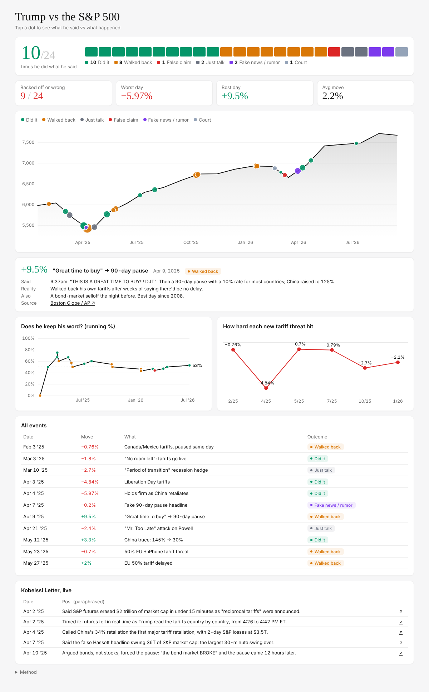

# Trump vs the S&P 500

What Trump said vs what he actually did, and how the S&P 500 reacted. 24 market-moving days from Feb 2025 to Jul 2026, each with a linked news source.



## What's on it

- **Follow-through score**: how often he did what he said (10/24), with every event as a colored block.
- **S&P 500 line**: monthly average close, with a dot for each event sized by that day's % move. Tap a dot for what he said, what actually happened, what else was going on that day, and the source.
- **Does he keep his word?**: running follow-through rate, counting only real promises (did it vs walked back vs false claim).
- **Tariff threat reactions**: the S&P's move the day after each new tariff threat. Liberation Day (−4.84%) is the outlier.
- **Kobeissi Letter**: their real-time posts on the big days, paraphrased and linked.

## Run it

```bash
npm install
npm run dev      # http://localhost:5173
npm run build    # outputs dist/
```

## Data

- `public/data/events.json`: one row per event (`said`, `did`, `tag`, `pct`, `context`, `source`, `url`).
- `public/data/spx_monthly.json`: S&P 500 monthly averages.
- `public/data/kobeissi.json`: Kobeissi posts.
- `scripts/build_events.py` rebuilds the event files.

Every source is listed in [DATA.md](DATA.md).

## Caveats

One day's move isn't proof of cause. Each event has a "what else was going on" note (jobs data, earnings, oil) so you can judge how much of a move was really Trump.

## Stack

Vite + vanilla JS + d3. Deployed on Vercel.
