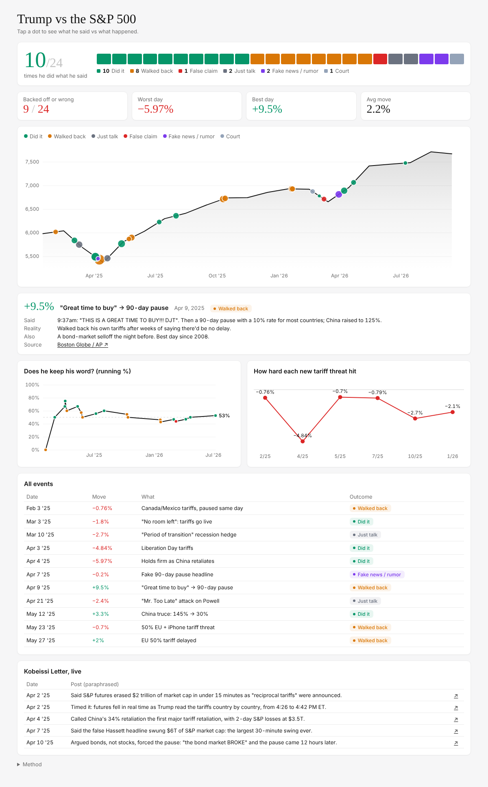

# Trump vs the S&P 500

**Live: [trump-vs-spx.vercel.app](https://trump-vs-spx.vercel.app)**

What Trump said vs what he actually did, and how the S&P 500 reacted. 24 market-moving days from Feb 2025 to Jul 2026, each with a linked news source.



## What's on it

- **Follow-through score**: how often he did what he said (10/24), with every event as a colored block.
- **S&P 500 line**: daily close, with a dot for each event sized by that day's % move. Tap a dot for what he said, what actually happened, what else was going on that day, and the source.
- **Does he keep his word?**: running follow-through rate, counting only real promises (did it vs walked back vs false claim).
- **Tariff threat reactions**: the S&P's move the day after each new tariff threat. Liberation Day (−4.84%) is the outlier.
- **Kobeissi Letter**: their real-time posts on the big days, paraphrased and linked.

- **The numbers**: abnormal returns per event, a permutation test, sector moves and a "TACO" backtest (below).
- **Auto-tagger**: big market days are scraped and tagged by an LLM; its agreement with the hand labels is shown on the page.

## Run it

```bash
npm install
npm run dev      # http://localhost:5173
npm run build    # outputs dist/
```

Pipeline (Python 3.13, `pip install -r requirements.txt`; `GROQ_API_KEY` optional, the LLM step is skipped without it):

```bash
python scripts/fetch_prices.py && python scripts/detect.py && python scripts/scrape.py && python scripts/extract.py && python scripts/event_study.py
```

`.github/workflows/daily.yml` runs the same chain every weekday after the close and commits the JSON if it changed. `build.yml` validates every data file against its schema (`scripts/validate.py`) and warns on dead source links.

## Data

- `public/data/events.json`: one row per event (`said`, `did`, `tag`, `pct`, `context`, `source`, `url`).
- `public/data/daily.json`: daily closes (`scripts/fetch_prices.py`).
- `public/data/study.json`: event study output (`scripts/event_study.py`).
- `public/data/kobeissi.json`: Kobeissi posts.
- `public/data/auto_events.json`, `public/data/calibration.json`: LLM-tagged days and the tagger's calibration.
- `data/`: pipeline working files (candidate days, scraped stories, cached LLM answers, `review_queue.json` for manual review).
- `scripts/build_events.py` rebuilds the hand-labeled event files.

Every source is listed in [DATA.md](DATA.md).

## Methodology

- **Event day**: the first trading day the market could react (after-close announcements map to the next session).
- **Abnormal return (AR)**: S&P 500 close-to-close return minus its mean daily return over trading days [−120, −11]. Standardized AR = AR / σ of that window. CAR sums AR over [0,0], [0,+1], [0,+5].
- **Sectors** (XLE, ITA, SOXX, FXI): market model, AR = r − (α + β·r<sub>SPX</sub>) with α, β from OLS on the same window. Day-0 ΔVIX in points and Δ10Y (^TNX) in bp.
- **Permutation test**: mean |AR| of the n event days vs 10,000 random draws of n non-event days (since 2024, each with its own estimation window). p = (#draws ≥ observed + 1) / 10,001. Run overall and by topic.
- **TACO backtest**: for each new tariff threat, buy SPX at the threat-day close and sell at the close of the day he walked it back, or after 5 trading days if he didn't. Baseline = mean SPX return over every holding period of the same length since 2024. No costs.
- **Auto-tagger**: days with |standardized AR| > 2 are scraped (AP's daily market story via WTOP), tagged by Groq (JSON mode, temperature 0) and schema-validated. Only Trump-related rows with confidence ≥ 0.8 are published; the rest go to a review queue. Calibration = a blind run on the hand-labeled days.

## Results

Data through Nov 19, 2026.

| | n | Result |
|---|---|---|
| Mean \|AR\| on event days vs random days | 24 | **2.19%** vs 0.63% (p < 0.001, 10,000 draws; p hits the test's floor) |
| …Tariffs | 16 | 2.49% (p < 0.001) |
| …Iran war | 6 | 1.28% (p = 0.011) |
| …Fed | 1 | 2.30% (p = 0.015, one event) |
| Event days with \|standardized AR\| > 2 | 24 | 11 |
| TACO backtest: avg return per trade | 6 | **+1.28%** vs +0.18% same-length baseline, avg hold 2.8 days |
| TACO hit rate | 6 | **6 / 6** (annualized Sharpe 25 from 6 trades: noise, not evidence) |
| Auto-tagger topic agreement | 13 | 92%, Cohen's κ **0.87** |
| Auto-tagger outcome-tag agreement | 13 | 23%, Cohen's κ **0.11** |

## Limitations

- **Selection bias.** The 24 events were picked partly *because* the market moved. That inflates the permutation result: it shows these days were unusual, not that Trump caused unusual days.
- **Small n.** 24 events, 6 trades, 13 calibration days. Treat everything as descriptive.
- **Confounding.** Many event days also had macro data, earnings or oil shocks (see each event's "Also" note). Estimation windows overlap other events (e.g. the April 2025 cluster), which inflates σ and shrinks standardized ARs.
- **Timing.** Close-to-close daily data can't separate a 9:37am post from the rest of the session.
- **LLM tagging.** On the hand-labeled days, `openai/gpt-oss-120b` (Groq) matched the topic 92% of the time (κ 0.87) but the outcome tag only 23% (κ 0.11, n=13). Outcome tags need hindsight a same-day story lacks, so auto events are routed to review unless high-confidence. 8 of the 13 calibration texts are the hand-labeled event's own linked article (WTOP no longer hosts AP stories older than ~8 months), so they aren't from the exact production source. Numbers live in `public/data/calibration.json`.
- One day's move isn't proof of cause. Each event has a "what else was going on" note so you can judge how much of a move was really Trump.

## Stack

Vite + vanilla JS + d3 on the front end, reading precomputed JSON. Python (pandas, numpy, yfinance, Scrapling, jsonschema) for the pipeline. Deployed on Vercel.
